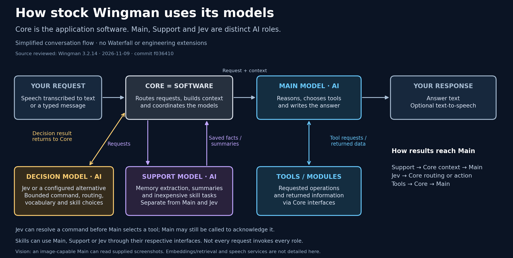
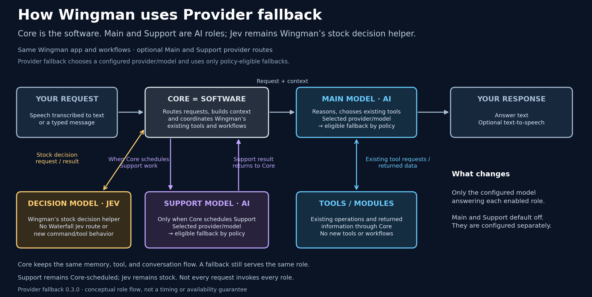
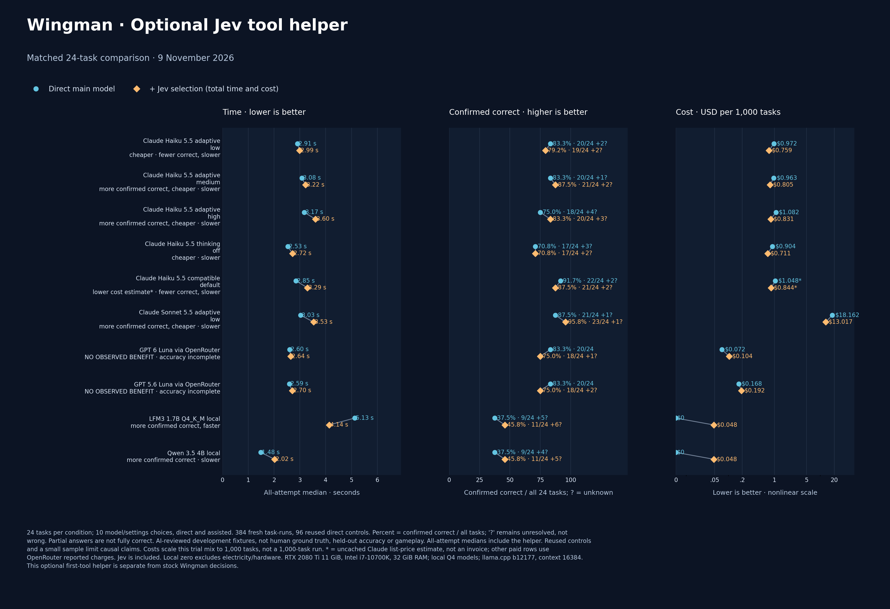
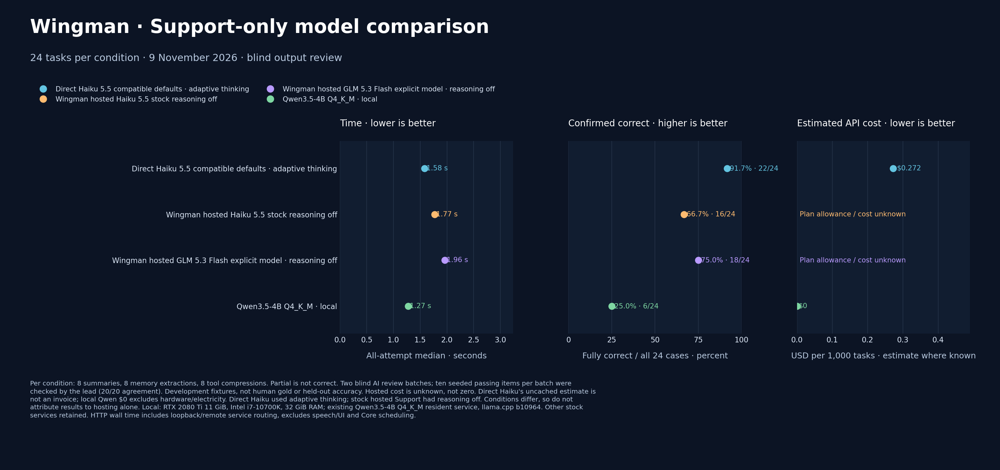

# Wingman API Waterfall

Wingman is still the same application. Core handles the conversation and its existing tools, memory, and workflows. **Main** answers the conversation. **Support** handles work Core already schedules, such as memory and summaries. **Jev** remains Wingman's stock decision helper.

Provider fallback only chooses a configured provider/model for Main or Support and, when the selected policy allows, tries an eligible fallback. Your existing gameplay tools and workflows stay the same. Main and Support are independent and both are off by default.

*Stock Core conversation flow, including the existing roles and tools.*

*Same Core and stock roles. Waterfall changes which configured model answers each enabled Main or Support request.*

## Setup

Requires Wingman AI 3.2.14 or later with the public v3 skill API. Download the skill ZIP from [Releases](https://github.com/Fowlplaychiken/SC-Wingman-API-Waterfall/releases). Extract its `provider_fallback` folder into Wingman's `custom_skills` folder, fully quit/reopen Wingman, then enable **Provider fallback** for your chosen Wingman. On Windows, the folder is `%APPDATA%\ShipBit\WingmanAI\custom_skills`.

Choose which role you want to route:

- **Main** is the model that answers conversations and handles the tools already available to that Wingman.
- **Support** is called only when Core schedules Support work. It does not replace Main or handle tools.

1. Add provider keys in Wingman's **Secrets** settings, if needed.
2. Ask your Wingman: **“Open provider fallback setup.”** Open the link in its dialog.
3. Select Main, Support, or both. Add providers, choose models, and arrange them in your preferred order. An unselected role stays unchanged.
4. **Preview changes**, **Apply reviewed changes**, then **Activate saved setup**. Wingman reloads the configuration; you do not need to restart the game.

Setup handles internal connection details. Provider keys never enter the page. Available-model lookup is optional; you can enter a provider's model ID instead. API calls may cost money. **Undo last setup** restores previous routing if those settings have not since changed.

Support is optional: current Wingman server mode also uses remote embeddings. Configure a compatible remote embedding endpoint in Wingman first, or leave Support unchanged. Main does not need it. See the [manual alternative](CONFIGURATION.md) for custom configuration.

## Context and reply limits

In setup, expand **Context and reply limits (optional)** for a BYOK or local model. Enter the context size actually available from that provider/server, the maximum reply, and room for tool results. Leave the fields blank to keep existing behavior. Wingman-hosted Support keeps Wingman's limits.

Tool-result continuations can use the reserved room. Waterfall does not silently delete messages to make a smaller fallback fit. If a request cannot fit, it explains the limit instead. Input counts are padded estimates, not exact provider billing counts.

When Main has a configured context size, setup uses its real primary model ID so Wingman can apply its normal model-aware budget. Core still uses its own model table; unknown models retain its conservative default. These settings cannot increase Core's or a provider's actual limit.

## Before you enable a route

Provider calls may incur charges. Fallback depends on the role's policy and the failure type; a refusal, uncertain timeout, or interrupted stream is not replayed through another provider. Waterfall does not report provider billing totals. Review the [route and failure details](CONFIGURATION.md#fallback-and-billing) before enabling automatic fallback.

To stop using Waterfall, restore the previous Core Main and Support settings before disabling the skill. Turning a role off does not rewrite Core's selected provider settings.

## Further reading

- [Exact manual setup and route format](CONFIGURATION.md)
- [Stock Main, Support, and Jev roles](docs/MODEL-ROLES.md)
- [24-task Main and Jev comparison](benchmarks/WINGMAN-JEV-PAIRED-COMPARISON.png): synthetic source replay, not live gameplay evidence
- [24-task Support comparison](benchmarks/SUPPORT-REPORT.md): separate memory, summary and tool-compression tasks

“Provider defaults” leaves the provider's thinking settings unspecified. Haiku
5.5 already uses adaptive thinking by default; it is not a separate model.
The other Haiku rows explicitly choose an effort level or disable thinking.

### Main comparison

The optional first-tool helper is an additional Main-path experiment; it is not Wingman's stock Jev behavior. The chart is a synthetic source replay, not live gameplay evidence.

### Support comparison

Support tasks are separate from the Main tasks and use AI-reviewed development fixtures, not a human gold set or live gameplay.
