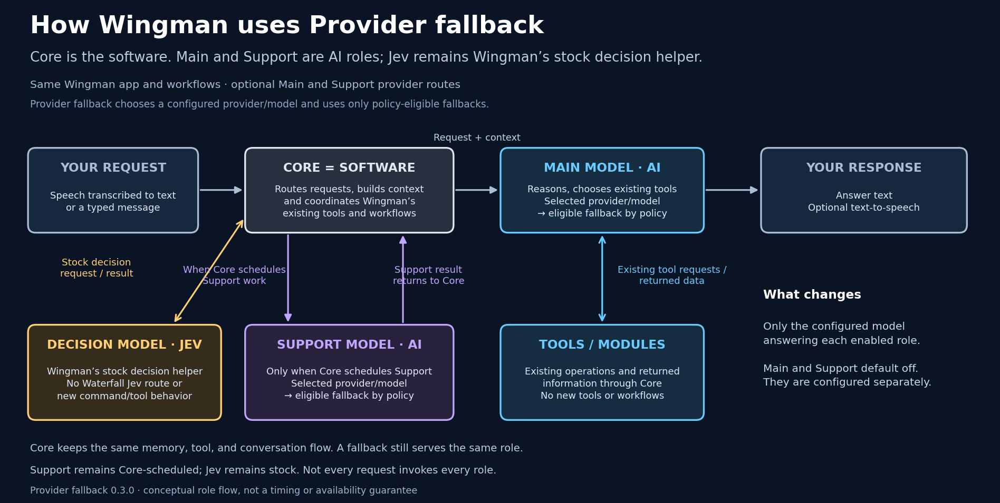
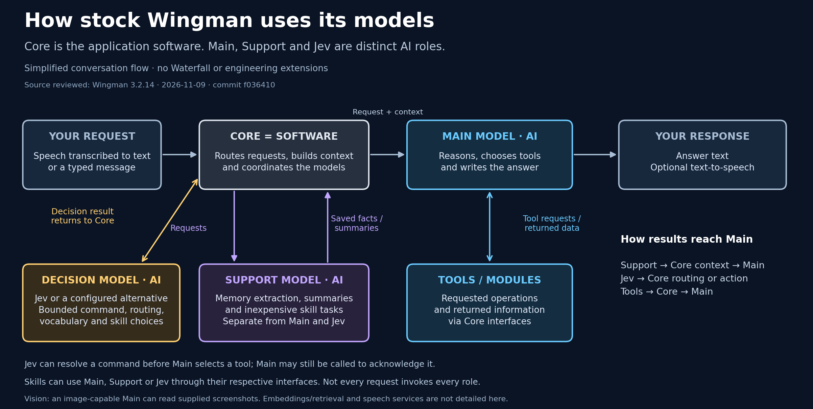
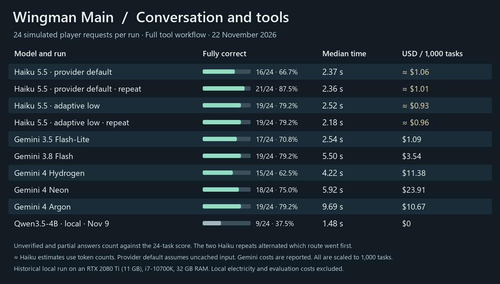
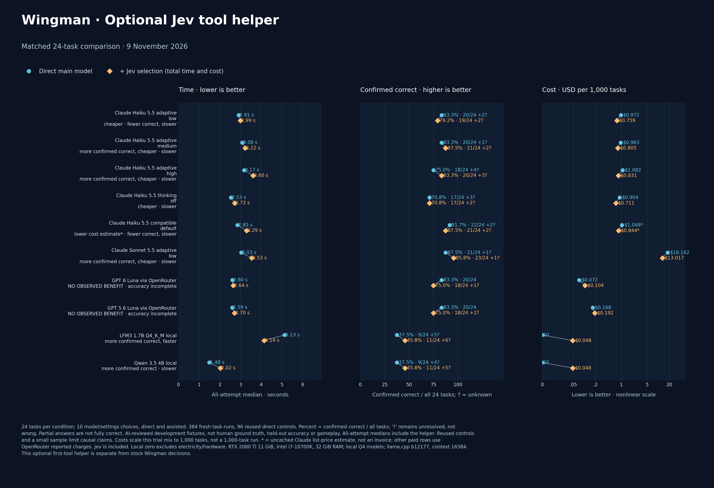
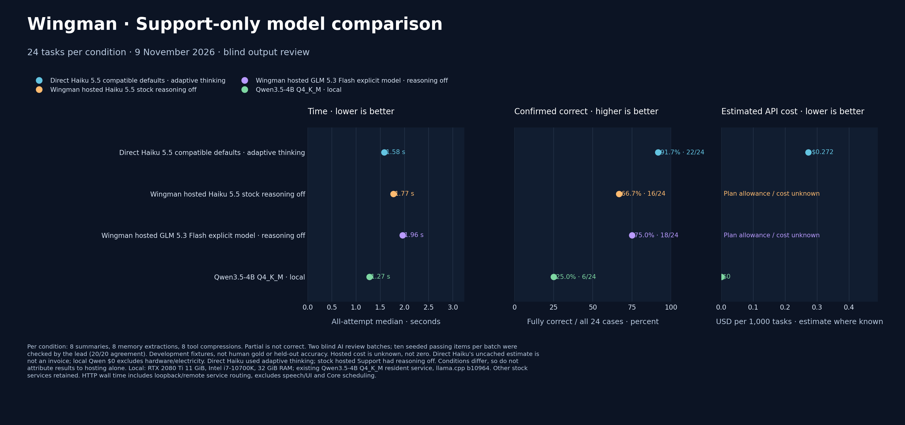

# Wingman API Waterfall

Choose a preferred AI model and a backup for your Wingman. Waterfall routes its conversation model (**Main**), its background model (**Support**), or both through providers you configure. You keep Wingman's existing voice controls, tools, memory and workflows.

**v0.4.4** · **Wingman AI 3.2.14+ / custom skill API v3** · [Download the install ZIP](https://github.com/Fowlplaychiken/SC-Wingman-API-Waterfall/releases) · [Manual configuration](CONFIGURATION.md)

Use hosted APIs, a compatible local model server, or a mix. Main and Support are independent and start **off**. Waterfall works as a standalone Wingman skill; it does not require other Star Citizen modules.

## Install and choose your models

1. Download the skill ZIP from [Releases](https://github.com/Fowlplaychiken/SC-Wingman-API-Waterfall/releases) and extract it. Copy the `provider_fallback` folder into Wingman's `custom_skills` folder. On Windows, paste `%APPDATA%\ShipBit\WingmanAI\custom_skills` into File Explorer's address bar. The final path should end in `custom_skills\provider_fallback\default_config.yaml`.
2. Fully quit and reopen Wingman, then enable **Provider fallback** for your chosen Wingman. Keep a backup of your profile and previous skill folder before upgrading.
3. Add any provider keys through Wingman's **Secrets** settings. For a local server, make sure its compatible endpoint is available.
4. Ask **“Open provider fallback setup.”** Open the private link shown in Wingman's dialog.
5. Select **Main**, **Support**, or both. Add your providers, choose their model IDs, and put them in the order you want. Leave a role unselected to keep its existing setup.
6. Choose **Preview changes**, **Apply reviewed changes**, then **Activate saved setup**. Wingman reloads the configuration. You do not need to restart the game.

The setup page handles the internal connection details. Provider keys stay in Wingman's secret store. Available-model lookup is optional; you can enter a provider's exact model ID instead. Close the page when finished. Its private link expires after 15 idle minutes; ask to open setup again for a new link.

**Which role should I choose?** Start with Main if you want to route spoken conversations and their existing tools. Support is for work Core already schedules, such as memory extraction and summaries, and its server settings are shared across the Wingman app. Remote Support also needs Wingman's separate compatible embedding endpoint; leave Support unchanged if you do not have one. Jev remains Wingman's decision helper.

## Use it in Wingman

Once setup is active, keep making your usual requests. You do not need to name Waterfall for every conversation. These requests help manage the routes:

| Say or type | What it does |
| --- | --- |
| “Open provider fallback setup.” | Opens the local page to review or change models and their order. |
| “Show Provider fallback status for Main.” | Shows the Main routes and their current health. Ask for Support to inspect that role instead. |
| “List available models for my route named backup.” | Queries the configured route with that ID. Use the route ID you chose in setup. |
| “Reset Provider fallback exhaustion for Main.” | Clears remembered exhaustion after you have repaired the account or key. You can request Support separately. |

Wingman interprets ordinary phrasing and calls the skill's typed tools. The tool names are `provider_fallback_setup`, `provider_fallback_status`, `provider_fallback_models` and `provider_fallback_reset`; status and reset accept a `main` or `support` role.

## When a provider fails

Each role has its own fallback policy. New configurations default to **Credit exhaustion only**. Choose **Provider availability** if you also want eligible temporary failures to try a backup, or **Manual only** to avoid automatic fallback. Advanced per-route settings can override the role policy. Older Main profiles without a policy retain their previous availability behavior.

| What happens | What to expect and do |
| --- | --- |
| The provider explicitly reports exhausted credits / HTTP 402 | An eligible backup can be tried. The exhausted account stays skipped until reset, a credential update, or module restart. Restore credits, then request a reset. |
| Rate limit, eligible server error, or connection failure | Availability policy can try an eligible backup and temporarily cool down the failed route. Check status; a temporary cooldown is not a declaration that your credits ran out. |
| Missing key, HTTP 401 or 404 | The request fails unless the selected policy permits a backup. Check the secret reference, endpoint and model ID, then reset or repair the configuration. |
| Policy refusal / HTTP 403 | The refusal stays visible. Waterfall does not send it to another provider to get around the refusal. |
| Uncertain timeout, HTTP 504, or interrupted response/stream | The request stops without replay through another model. Check the outcome before making a new request. |

Only eligible failures before successful response headers can fall through. If no route is usable, you see an error. Switch notices identify the role and route/model when available. After recovery, the next request can try the preferred route again and report its successful return. A reset does not add credits.

API calls may cost money on **any attempted route**. Switching models can change price and capabilities. Waterfall does not report provider billing totals, and separate keys or model names can share one account's quota. See [failure policies and billing limits](CONFIGURATION.md#fallback-and-billing).

**Return to your previous setup:** use **Undo last setup** while the saved settings still match that setup, then activate the restored configuration. Otherwise restore the previous Core Main and Support settings from your backup. Do this **before disabling or removing Waterfall**; turning a role off does not restore Core's previous provider selection. If setup saves but activation fails, reload the configuration in Wingman.

## How it fits

Core still schedules work and executes tools. Waterfall selects a configured provider/model for enabled Main or Support requests. Main and Support do not become a new chain that every request must pass through.

Compare Wingman's stock flow

The same roles, tools and workflows remain in place. [Read about Main, Support and Jev](docs/MODEL-ROLES.md).

### Context and reply limits

In setup, expand **Context and reply limits (optional)** for a BYOK or local model. Enter the context actually available from that provider/server, the maximum reply, and room for tool results. Leave the fields blank to keep existing behavior. Wingman-hosted Support keeps Wingman's limits.

Waterfall checks whether a request fits; it does not silently delete conversation messages to squeeze them into a smaller backup. Tool-result continuations can use the reserved room. Counts are padded estimates rather than exact provider billing counts, and these settings cannot increase a model's or Core's actual limit. See [context budgets](CONFIGURATION.md#optional-context-budgets).

## Measured examples, with limits

These comparisons help explain tradeoffs in the tested configurations. They use **AI-reviewed development fixtures**, not a human gold set, held-out qualification, or live gameplay. They do not establish that one model is best for every Wingman task. Timings exclude speech, UI and Core scheduling; cost estimates are not invoices, and unreported hosted billing remains unknown.

### Main · Conversation and tool workflows

On the paired repeat, Haiku at provider defaults answered 21/24 correctly in 2.36 seconds. Explicit low effort answered 19/24 in 2.18 seconds. The first runs scored 16/24 and 19/24. [See the tasks, costs and scoring](benchmarks/gemini-2026-11-22.md).

Earlier Main comparison with and without the optional Jev helper

This experiment adds a first-tool selection call to individual Main routes. Wingman’s stock Jev decisions have their own workflow. [Earlier Main trial and results](benchmarks/REPORT.md).

### Support: memory, summaries and tool-result compression

Support uses a different 24-task workload and must not be combined with Main into one ranking. Hosted and direct conditions also differ in reasoning settings, so they do not isolate a hosting effect. [Support trial methods, scores and cost assumptions](benchmarks/SUPPORT-REPORT.md).

“Provider defaults” leaves the provider's thinking settings unspecified. In the recorded Haiku 5.5 trials that meant adaptive thinking; other chart rows explicitly selected an effort level or disabled thinking.
