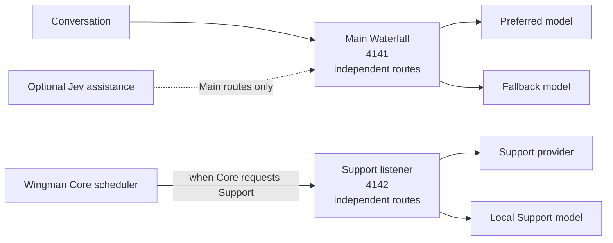

# Wingman API Waterfall

**This routes Wingman's main conversation model:** the model that reasons,
chooses tools and answers. Version 0.3 also adds a separate, optional Support
chain for requests Core already schedules, such as conversation summaries. Main
and Support keep independent provider chains and credential references. Core
continues to own when summarization runs and how its results affect memory; this
skill does not schedule summaries or change memory policy. The separate Jev
decision provider and speech keep their existing settings. Core couples remote
Support mode with a separate remote embedding endpoint; preserve your embedding
model and endpoint when changing that mode so existing memory stays compatible. Optional
per-route Jev assistance uses Wingman's decision interface, not the Support
chain. See the [model-role map](docs/MODEL-ROLES.md).


**Install without changing Wingman. Configure a provider order only if you want automatic fallback.**

```text
Your voice or text → Wingman → API Waterfall → your first available model
                                1. Preferred API
                                2. Another API (optional, repeat as needed)
                                3. Local / second-computer model (optional)
```

When you explicitly enable Main, this optional Wingman v3 skill runs its bearer-protected Main endpoint on your computer. It forwards conversations, images and tool calls through the providers **you configure, in your order**. The independent Support listener starts only when Support is separately enabled. Wingman continues to execute its tools. There are no Core patches, model downloads, bundled credentials or other-project services.

## Quick setup

[Download the skill ZIP](https://github.com/Fowlplaychiken/SC-Wingman-API-Waterfall/releases/latest) · [Source](https://github.com/Fowlplaychiken/SC-Wingman-API-Waterfall)

1. Back up your Wingman profile/settings and keep the previous skill ZIP for rollback.
2. Install `provider_fallback-0.3.0.zip` into `custom_skills` and restart Wingman so its skill catalogue sees the package.
3. A fresh install leaves **Main and Support disabled**. No new endpoint or key is needed unless you choose a route.
4. To use Main, configure its ordered route list and secret references, set `main_enabled: true`, then select Main's local-compatible endpoint (`http://127.0.0.1:4141/v1`, model `waterfall`) in Core. Set `bridge_secret_name` to `local_llm`; put a strong local bridge password in Wingman Secrets under that name. This is a local password, not a provider API key.
5. To use Support, configure its separate ordered routes and set `support_enabled: true`. Point Core's existing Support provider at `http://127.0.0.1:4142/v1` with model `local-model`; Core supplies the fixed local auth internally. Do not copy the Main bearer or enter a separate Support key.
6. Apply the settings and use **Provider fallback status** for a read-only check of the Main route. Support has no status/reset/admin endpoint on its listener.

Wingman's `local_llm` secret is shared across its Wingmen. Before changing it,
check whether another profile needs a different authenticated gateway key.



Core owns when Support runs and how summaries enter its memory policy. Main
answers and Support summaries use independent route lists and credential
references. Jev assistance is optional on Main routes only; Support cannot call
it. For a worked role overview, see the [model-role map](docs/MODEL-ROLES.md).

## What it does

- Accepts any number of ordered compatible provider/model entries; there is no fixed provider-count limit.
- Skips a provider after a definite credit-exhaustion response, including on later requests. It stays skipped until you reset it, update that credential, reconfigure or restart the skill.
- Provides three fallback modes: `credits_only` (recommended for new profiles), `availability`, and `manual`. Existing profiles without this setting retain `availability`; a route’s explicit `fallback_on` list overrides the preset. Rate limits and service unavailability are temporary rather than automatically called spent credits.
- Reports provider switches and recoveries with visible notices by default, including provider/model and a warning that cost and capabilities can change. If the optional `notify_switches` setting is turned off, transition notices are suppressed; request failures still return as errors. Redacted failure facts contain no prompt, key or raw provider error body.
- Offers model IDs from each configured provider so you can copy an exact ID. You choose the model; the module does not benchmark or choose it for you.
- Can end with a local OpenAI-compatible server on your computer or another Windows/Linux machine. The module runs alongside Wingman; remote inference remains the server's job.
- Owns its loopback listener and closes it on skill unload. It creates no scheduled task or permanent background daemon.
- Supports native Anthropic Messages with explicit thinking/effort settings, alongside existing OpenAI-compatible routes. Native Messages currently accepts nonstreaming conversation requests; compatible routes retain streaming.
- Optionally asks Wingman's existing decision model to narrow the first tool choice on a text turn. This is off by default: it can increase latency, cost or mistakes. An uncertain or unavailable decision keeps the full tool list; exhausted Jev credits disable assistance until reset. A provider refusal stays a refusal.

## Optional Support chain

Support is disabled by default. Set `support_enabled: true` only when you want
this skill to handle Support requests that Core has already scheduled. Enabling
the chain consents to requests attempting configured routes in order when the
selected fallback policy permits; API charges may apply at any attempted route.
The default is `credits_only`; generic backend errors and temporary failures do
not trigger fallback under that preset. `availability` and route-specific
`fallback_on` overrides are explicit broader choices. The provider gateway may
also apply its own retries, which this skill cannot observe or control. There is no second
confirmation per fallback.
Choose models and credential references deliberately. Do not infer that a route
is free from its provider label, secret name or lack of a key field. Switch and
recovery notices identify the provider/model and warn that costs can change.
The module does not calculate or display actual billing. These notices use the existing
`notify_switches` setting (on by default). Disabling notices does not convert a
failed request into success. Failure diagnostics use bounded request IDs and
redacted details, never raw prompts, keys or provider error bodies.

The Support chain is independent from Main. Changing Support routes does not
replace Main's Waterfall bearer or Main provider/model. Main continues to use
port `4141` and its configured bridge secret reference. Support uses
its own infer-only, OpenAI-compatible listener at `http://127.0.0.1:4142/v1`;
configure Wingman's existing Support provider to use model `local-model`. Core
supplies the fixed local auth value `not-needed`; do not copy the Main bearer or
enter a separate Support key. The listener accepts only local model-list and
text completion requests, rejects tools and streaming, and has no
cross-origin/browser or LAN access. Status/reset handlers are not reachable
through the Support listener. Local software running as your Windows user can
reach this stock-compatible listener; it is not an isolation boundary from other
programs on your computer.

For a Support route using `wire_protocol: "wingman_support"`, the upstream
route endpoint itself must end in `/support/completions` (for example, the
provider's documented support-completion URL). This is distinct from the local
listener's `/v1/chat/completions` endpoint.

Role enablement and Support listener settings are:

| Setting | Default | Meaning |
| --- | --- | --- |
| `main_enabled` | `false` | Explicit opt-in to the Main Waterfall route. |
| `fallback_mode` | `credits_only` | Main route fallback policy; existing profiles that omit it retain legacy `availability`. |
| `notify_switches` | `true` | Show Main provider switch and recovery notices. |
| `support_enabled` | `false` | Explicit opt-in to the configured Support route chain. |
| `support_listen_port` | `4142` | Dedicated loopback Support listener port; keep it distinct from Main. |
| `support_routes_json` | `[]` | Ordered provider/model routes. Configure valid routes before enabling Support. |
| `support_fallback_mode` | `credits_only` | Independent Support fallback policy; choose `availability` or `manual` explicitly when appropriate. |

A fresh install needs no new endpoint, API key or settings: Main and Support are
both disabled. When upgrading from 0.1/0.2, check **Enable Main fallback**: Core may
add the new disabled default while refreshing the skill. Re-enable it to retain
your already configured Main route. No stock settings are rewritten. An enabled role requires a valid ordered route
list. Missing/invalid route settings cause a visible module configuration error
rather than silently choosing a model. Core continues to own Support scheduling
and memory policy.

A profile can order Wingman-hosted Haiku through an existing `wingman_pro`
credential reference, then an own-API Haiku through a separate existing secret
reference, then a final local Qwen-compatible endpoint. Replace these illustrative
choices with providers/models available to you. The final local route avoids
per-call API charges but still uses host resources. Keep endpoints and secret
*names* in the profile; put key *values* only in Wingman Secrets. The generic
skill defaults contain no personal endpoints, model IDs or keys.

For the stock Wingman Support completion contract, mark only that route with
`wire_protocol: "wingman_support"`; its adapter sends the stock Support request
to the configured upstream `/support/completions` endpoint. Other routes must
use a protocol they actually support, such as `openai_chat` or the existing
`anthropic_messages` adapter. An optional `omit_request_fields` list can remove
inherited sampling or other optional fields unsupported by a route. It does not
remove the required prompt, model or completion contract. Unsupported protocols
or malformed route settings fail explicitly; they do not fall back to Main.

Back up the current Wingman profile/settings and keep the previous skill ZIP
before upgrading. Build or install the versioned `provider_fallback-0.3.0.zip`,
then enable Support only after its routes and secret references are configured.
To roll back, restore the saved settings and previous skill package. The Main
endpoint and bearer remain separate throughout.

Example routes (replace model IDs and secret **names**, not key values):

Configure `routes_json` as an ordered JSON array. Each object has `route_id`, full `endpoint`, `model`, optional Wingman `secret_name`, optional `request_overrides`, and optional `final_local`. `wire_protocol` defaults to `openai_chat`; use `anthropic_messages` for Anthropic's native `/v1/messages`. Copy exact available model IDs from your provider; availability, capabilities and pricing change. Compatible examples include `https://api.openai.com/v1/chat/completions` and `https://openrouter.ai/api/v1/chat/completions`. A local or remote compatible server can be another route. Model/tool/image and parameter support differ by provider; a configured endpoint is not proof of compatibility.

```json
[
  {"route_id":"preferred","endpoint":"https://api.anthropic.com/v1/messages","wire_protocol":"anthropic_messages","model":"YOUR_MODEL_ID","secret_name":"YOUR_CLAUDE_SECRET_NAME"},
  {"route_id":"backup","endpoint":"https://api.openai.com/v1/chat/completions","model":"YOUR_MODEL_ID","secret_name":"YOUR_OPENAI_SECRET_NAME"},
  {"route_id":"local","endpoint":"http://127.0.0.1:11434/v1/chat/completions","model":"YOUR_LOCAL_MODEL","final_local":true}
]
```

Delete unwanted entries; the local entry is optional and, when marked `final_local`, must be last. `request_overrides` can hold supported provider parameters, but cannot replace conversation messages, tools, model or streaming mode. Do not assume another provider's reasoning settings are honored: Anthropic's compatibility endpoint, for example, does not honor OpenAI `reasoning_effort`.

### Optional decision assistance

Set `"jev_assist": true` on an individual route only if its tasks benefit. Configure Wingman's own **Decision Model** provider/key first; this module uses its public `system_one` interface, not a second Jev provider. The optional `jev_min_confidence` defaults to `0.8`. Below that threshold, disabled decisions, nontext/image requests and tool-result follow-ups retain the original request. A fresh user turn may select again. An exhausted Jev account falls back to the same main model directly, with no repeated credit probe until reset. Missing public support also leaves normal inference working.

Selecting one first tool does not validate its arguments or answer. Subsequent tool-result turns receive the original full catalogue, so a multi-step request can still use other tools. A 24-task paired development comparison is available below. Assistance is task and model dependent; leave it off for an unmeasured setup.

### Native Messages limits

Native routes preserve opaque signed thinking in assistant history without exposing reasoning as spoken text. Keep that history unchanged for a tool follow-up. Native Messages currently rejects `stream: true` before sending; use Wingman's nonstreaming main conversation path or a compatible route. Base64 JPEG/PNG/GIF/WebP image blocks are supported; remote image URLs and unsupported content fail explicitly. Thinking/effort controls are forwarded only from explicit route overrides, not guessed from compatible defaults. Follow your selected model's supported settings.

Signed blocks stay with their original endpoint, secret reference and model. A different fallback receives the visible conversation and tool results without those opaque blocks. If you replace a key with one belonging to a different account under the same secret name, start a new conversation; provider signatures can be account-specific.

### Useful requests

- “Show provider fallback status.” → `provider_fallback_status`
- “List models for route preferred.” → `provider_fallback_models(route_id="preferred")`
- “Reset exhausted provider routes.” → `provider_fallback_reset`
- “Reset exhausted providers for Support.” → `provider_fallback_reset(role="support")`

If fallback happens, a visible notice names the role, model and reason when
available. After restoring credits, reset that role; its next request tries the
preferred provider again and announces recovery when successful. Replacing the
stored key or restarting the module also clears its exhausted state. A reset
does not add credits; failure log entries remain available afterward.

These tools are also available directly in Wingman's tools interface. The hosted Support catalogue remains in Wingman’s own settings. A model listing is not a benchmark or a guarantee of tool/image compatibility. Some providers paginate their model listings; the current tool returns the first advertised page only.

## Fallback choices and diagnostics

Choose `credits_only` to fall back on definite exhaustion, `availability` to include configured authentication/model and temporary availability failures, or `manual` to disable automatic fallback. The route-specific `fallback_on` list can specify `credit_exhausted`, `authentication_or_model_unavailable`, `temporary_unavailable`, and `connection_unavailable`, including an empty list. This list overrides the preset for that route. Policy refusals and uncertain or partial responses remain terminal. A gateway may independently select or retry providers for the same model; Waterfall does not control or observe those internal hops.

`provider_fallback_status` reports route states and the last selected route. Failure log entries can include a generated request ID, bounded route/model identifiers, a fixed reason and safe HTTP status, rather than secrets or message content. Successful responses expose the request ID in `x-wingman-waterfall-request-id`; not every early failure currently carries one. Switch notices can be disabled with `notify_switches`; failure diagnostics remain enabled. Notification delivery failure is reported in status when observable. These are local diagnostic records, not a billing ledger or a claim about hidden gateway attempts.

A configured route is a provider/model reference, not proof that its account has independent quota. If multiple routes share one provider account, they may draw from the same credit pool even when they use different keys or model names. Report account-level exhaustion only when the provider makes that scope clear; otherwise keep it unknown. This skill does not ship a profile-specific provider, model, host or credential reference.

### Development comparison

#### Short-history Support comparison


Eight short tasks compare full history with a prepared summary and hosted Support; this is not a long-context or native gameplay test.

#### Main and stock Support comparison


A separate 24-task source replay compares Main/Support model pairs and stock Jev; it does not test this module's optional Main helper.

#### Main-model Jev comparison


A 24-task synthetic comparison of Main routes with the optional first-tool helper; results are not live-session or gameplay evidence.

The [24-task Jev comparison](benchmarks/WINGMAN-JEV-PAIRED-COMPARISON.png) and [results](benchmarks/WINGMAN-JEV-PAIRED-COMPARISON.json) contain 480 attempted case-runs across ten settings, with 96 prior direct controls reused. The [short-history Support comparison chart](benchmarks/WINGMAN-SUPPORT-FOLLOWUP-2026-11-09.png) and [report](benchmarks/WINGMAN-SUPPORT-FOLLOWUP-2026-11-09.md) compare full history, ready summaries and hosted Support. These are AI-reviewed development fixtures, not human-reviewed held-out benchmarks; unknown outcomes remain separate from wrong answers.

| Selected configuration | Fully correct / 24 | Unknown | All-attempt median | Estimated API cost / 1,000 tasks |
| --- | ---: | ---: | ---: | ---: |
| Haiku compatible, direct | 22 | 2 | 2.85 s | $1.048* |
| Qwen 3.5 4B, with Jev | 11 | 5 | 2.02 s | $0.048 |
| Qwen 3.5 4B, direct | 9 | 4 | 1.48 s | $0 API fee |

*Hypothetical uncached token list-price estimate, not a billed amount or verified upper bound; cache detail was unavailable. Jev cost is included where used. Local API fees exclude hardware and electricity. Medians include all attempts, including partial and unsuccessful outcomes. Local measurements used an RTX 2080 Ti 11 GiB, Intel i7-10700K, 32 GiB RAM, Q4 models and llama.cpp b12177 with a 16,384-token context. These limited results do not establish universal accuracy, native end-to-end latency or a causal Jev benefit.

## Failure behavior

The default fallback preset for new Main and Support routes is `credits_only`; legacy Main profiles that omitted it keep `availability`. The following table describes outcomes **when allowed by the selected preset or route override**. Noneligible failures return rather than automatically choosing another route. The gateway's own retry behavior is separate; Waterfall does not claim to control or observe internal gateway hops.

| Response | Behavior |
| --- | --- |
| Definite credit exhaustion / HTTP 402 | Skip that account for later requests until reset or relevant credential change |
| HTTP 429 or 500/502/503; Claude 529 overload | Try the next route; temporary cooldown, not sticky credit exhaustion |
| Missing key, HTTP 401 or 404 | Skip the affected route until reset/configuration or credential repair |
| Connection cannot be established | Try the next route; temporary cooldown |
| Content/policy refusal or HTTP 403 | Return the refusal; do not route around it |
| HTTP 504, ambiguous timeout, broken response or partial stream | Stop this request; do not silently replay it through another model |

Only eligible failures before successful response headers can fall through. If a stream fails after starting, the module cannot truthfully know whether the provider finished processing; it does not duplicate that work elsewhere. If every route is unavailable, Wingman gets a redacted error rather than an invented answer. Exhaustion/cooldown state lives in memory; it is not a durable billing ledger.

Version 0.1.1 also recognizes Claude's specific HTTP 400 low-credit response;
other HTTP 400 errors remain terminal. See [Claude's error reference](https://platform.claude.com/docs/en/api/errors).

Unrelated secret saves do not clear exhausted routes. Updating a configured provider's key clears the relevant route state; changing the bridge bearer restarts its owned listener. Provider billing still applies to API calls. There is no promise of free inference or universal protocol support.

## For maintainers

The package builder includes the existing role modules and stamps the release
from `default_config.yaml`'s semantic version. Main and Support share routing
primitives but keep separate listeners, route policy and secrets. See
`build.py` and the focused routing/listener tests
for release maintenance.
