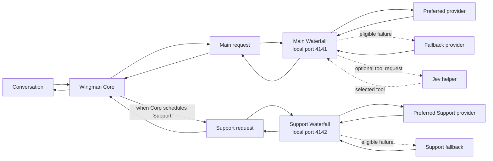

# Wingman API Waterfall

Route Wingman's Main conversation model through preferred and fallback providers.
An optional, separate Support chain can serve support work Core has already
scheduled. Core keeps its scheduler and memory policy; Main and Support keep
separate routes and credential references. Jev assistance is Main-only.

*Stock Wingman flow: Main and Support are separate roles, coordinated by Core.*

## With Waterfall enabled

Core decides whether to make a Support request. Main results and Support
summaries return to Core; they do not call each other. Installing Waterfall disabled leaves the stock providers unchanged. To stop
using it later, restore your previous Core Main/Support settings before
disabling the module; switching it off does not rewrite those settings.

## Quick setup

1. Back up your Wingman profile/settings and keep the previous skill ZIP. Extract
   `provider_fallback-0.3.0.zip` into `custom_skills`, then restart Wingman.
2. Choose your Wingman, open **Skills**, and add **Provider fallback**. On a
   fresh install both roles remain disabled; no route or provider key is needed
   until you choose to enable one.
3. **Main:** configure its ordered routes and existing provider secret
   references. In Provider fallback, set `bridge_secret_name` to `local_llm`,
   then store a strong random *local bridge password* in Wingman Secrets under
   `local_llm`. This is not a provider API key. Set `main_enabled: true`. In
   Core's conversation provider, choose the existing local/OpenAI-compatible
   provider, endpoint `http://127.0.0.1:4141/v1`, model `waterfall`, and use the
   same local bridge password.
4. **Support (optional):** configure independent Support routes and set
   `support_enabled: true`. In Core's Support Model settings, choose **Remote**;
   set **Support Model host** to `http://127.0.0.1` and **Port** to `4142`.
   Core supplies its fixed `local-model` alias and local auth internally. Do not
   copy the Main bearer or enter a Support API key.
5. Remote Support mode also uses Core's separate remote embedding settings.
   Preserve the existing compatible embedding host, port and model. If you do
   not have a reachable compatible embedding endpoint, leave Waterfall Support
   disabled. This does not affect Main.

### Upgrade an existing Main setup

Back up the profile and previous ZIP first. Core may merge the new
`main_enabled: false` default into an existing profile. After upgrading, check
**Enable Main fallback** and re-enable Main if the update disabled it. Existing
routes and credentials are not rewritten by this module.

## Routes, costs and recovery

Choose route order and failure policy. New Main and Support chains default to
`credits_only`; `availability` and `manual` are optional. Switch notices are on
by default and identify the role, route/model and reason when available; they
warn that cost or capability may change. Waterfall does not read or report
provider usage or billing totals, so treat route cost as unknown. API charges
may apply to any attempted route. Errors remain visible and failure logs are
redacted; they do not contain prompts, raw provider bodies or credentials. A gateway may
also retry internally; Waterfall cannot observe those hidden attempts.

After restoring credits, reset the affected role. Main uses
`provider_fallback_reset()`; Support uses
`provider_fallback_reset(role="support")`. The next request tries the preferred
route again and announces recovery when successful. Replacing the key or
restarting the module also clears exhaustion. A reset does not add credits;
failure log entries remain available. `provider_fallback_status()` is a
read-only Main status tool. The Support listener has no status or reset endpoint.

For route fields, supported protocols, fallback classifications, Jev, and
Anthropic Messages limits, see [CONFIGURATION.md](CONFIGURATION.md).

## Benchmarks

*AI-reviewed source replay: 24 short tasks across Main routes and optional Jev; not live-session or gameplay evidence.*

| Main route | Correct | Unknown | Fully correct % | Median | Est. API / 1,000 tasks |
| --- | ---: | ---: | ---: | ---: | ---: |
| Qwen 3.5 4B, direct | 9/24 | 4 | 37.5% | 1.48 s | $0.000 |
| Qwen 3.5 4B, optional Jev | 11/24 | 5 | 45.8% | 2.02 s | $0.048 |
| Haiku compatible, direct | 22/24 | 2 | 91.7% | 2.85 s | $1.048* |

Local rows used an RTX 2080 Ti 11 GiB, Intel i7-10700K, 32 GiB RAM and Q4
models. Costs are estimates for this trial mix; hardware/electricity are excluded.
The helper added latency and API cost in this sample; its outcome is not a
live-session accuracy guarantee.

- [Main/Jev JSON](benchmarks/WINGMAN-JEV-PAIRED-COMPARISON.json) · [CSV](benchmarks/WINGMAN-JEV-PAIRED-COMPARISON.csv)
- [Stock Main/Support report](benchmarks/WINGMAN-STOCK-ROLE-COMPARISON-2026-11-09.md) · [JSON](benchmarks/WINGMAN-STOCK-ROLE-COMPARISON-2026-11-09.json) · [PNG](benchmarks/WINGMAN-STOCK-ROLE-COMPARISON-2026-11-09.png)
- [Short-history Support report](benchmarks/WINGMAN-SUPPORT-FOLLOWUP-2026-11-09.md) · [JSON](benchmarks/WINGMAN-SUPPORT-FOLLOWUP-2026-11-09.json) · [PNG](benchmarks/WINGMAN-SUPPORT-FOLLOWUP-2026-11-09.png)
