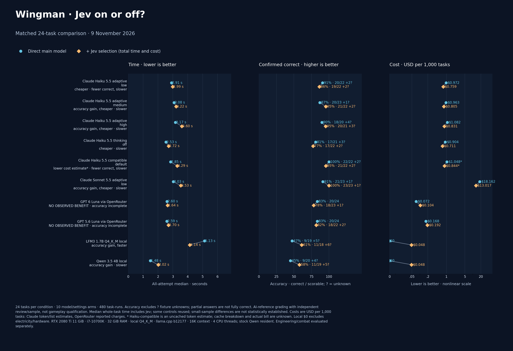

# Wingman provider comparison — 9 November 2026

The [paired comparison](WINGMAN-JEV-PAIRED-COMPARISON.json) contains 480 attempted case-runs across 10 model settings with and without Jev. It includes 384 new results and 96 reused direct controls. Each setting and mode has 24 frozen simulated tasks; tools return canned data and no game action is executed.

The tasks cover conversation, keybindings, radio, files, navigation, trading and status. The results use AI-reviewed development references, not human ground truth or a held-out sample. Unknown outcomes remain unknown, including uncovered fixture reads; correct counts are shown against the full 24 as well as scorable cases. These results do not establish universal assistant accuracy or native gameplay behavior.

The median is whole-task time across all attempts, including partial or unsuccessful outcomes. Jev-assisted timing includes the measured selection and main-model work; it does not independently establish installed Core latency. API costs include reported Jev charges where used. The compatible Haiku value is a hypothetical uncached token-price estimate, not an actual bill or a verified upper bound. Local API fees exclude hardware and electricity.

Local runs used an RTX 2080 Ti with 11 GiB VRAM, Intel i7-10700K, 32 GiB RAM, Q4 models, and llama.cpp b12177 with a 16,384-token context. Results are a small exposed sample, not causal model rankings. [CSV data](WINGMAN-JEV-PAIRED-COMPARISON.csv) · [SVG graphic](WINGMAN-JEV-PAIRED-COMPARISON.svg)
