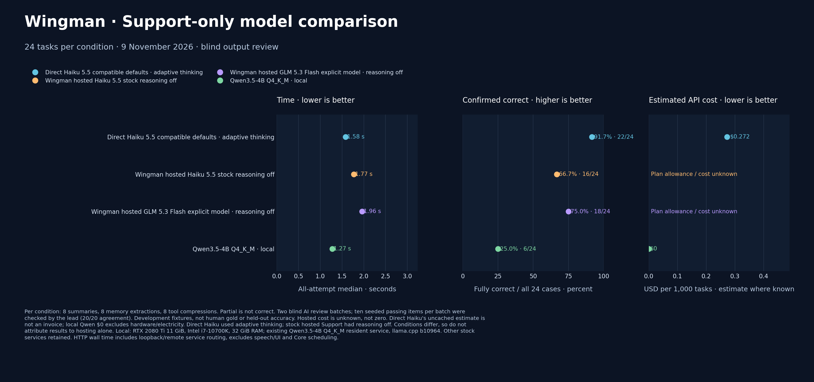

# Wingman Support-only comparison — 9 November 2026

Across this 24-case Support-only fixture, direct Haiku 5.5 produced **22/24 fully correct results** (21/24 strict), stock hosted Haiku produced **16/24**, explicitly selected hosted GLM 5.3 Flash produced **18/24** (17/24 strict), and local Qwen3.5-4B Q4_K_M produced **6/24** (5/24 strict). Median response times were **1.581 s**, **1.768 s**, **1.962 s**, and **1.273 s**, respectively. Hosted allowance or billing cost is **unknown**. Direct Haiku's hypothetical uncached token-list estimate is **$0.272354 per 1,000 tasks**, not an invoice; Qwen's **$0 API** excludes hardware and electricity.

[Full-resolution PNG](WINGMAN-SUPPORT-24.png) · [SVG](WINGMAN-SUPPORT-24.svg) · [Trial data](WINGMAN-SUPPORT-24.json) · [CSV](WINGMAN-SUPPORT-24.csv)

## Scores by task category

Values show Core-compatible fully correct results out of eight per category. The overall column shows compatible/strict results out of 24.

| Support condition | Conversation summaries | Memory extraction | Tool-response compression | Overall compatible / strict |
|---|---:|---:|---:|---:|
| Direct Haiku 5.5 · adaptive thinking | 8/8 | 7/8 | 7/8 | 22/24 · 21/24 |
| Wingman hosted Haiku 5.5 · reasoning off | 8/8 | 7/8 | 1/8 | 16/24 · 16/24 |
| Wingman hosted GLM 5.3 Flash · explicit selection, reasoning off | 7/8 | 8/8 | 3/8 | 18/24 · 17/24 |
| Local Qwen3.5-4B Q4_K_M | 2/8 | 3/8 | 1/8 | 6/24 · 5/24 |

Strict grades are retained in the trial data. Direct Haiku's compatible total accepts the lead's S003 adjudication. Qwen's total accepts Core JSON recovery for S029; S046 remains incorrect. For hosted GLM, S006 was corrected to pass because the prompt explicitly identifies Ren as a friend; the original strict grade is still retained, yielding 18 compatible versus 17 strict results. These transparent adjudications are not new independent grading or a human gold standard.

## Conditions and limits

Each condition covers the same frozen 24 prompts: eight memory extractions, eight conversation fact-sheet summaries and eight long tool-response compressions. There were two separate 48-output blind AI review batches. The lead checked ten seeded passing outputs in each batch, with 20/20 agreement, and reviewed failures and partials. This is an AI-reviewed development fixture, not a held-out estimate or human gold set. Partial is not fully correct.

Direct Haiku used compatible defaults with adaptive thinking. The stock hosted Haiku Support path turned reasoning off. GLM 5.3 Flash was explicitly selected from the catalog; it was not the omitted plan-default request. All 48 hosted results returned model IDs matching their requested IDs. Since these configurations differ, the results do not isolate or establish a causal effect of hosting.

These are model-level Support trials only. They do not cover Jev, Main, gameplay, complete memory acceptance or end-to-end Core scheduling. Local runs used an RTX 2080 Ti with 11 GiB VRAM, Intel i7-10700K and 32 GiB RAM, with Qwen served by llama.cpp b10964. HTTP wall time includes loopback or remote service routing and excludes speech, UI and Core scheduling.

Hosted allowance consumption and billed cost were not returned, so their cost remains unknown rather than zero. Direct Haiku's per-1,000 estimate scales observed prompt and returned completion token counts at listed uncached prices of $0.10 per million input tokens and $0.50 per million output tokens, including completion usage that may contain hidden reasoning. No cache breakdown is available, so this is not billed cost. Qwen's $0 API figure excludes hardware and electricity.

## Source and reproducibility

The comparison was generated from [the scored JSON](WINGMAN-SUPPORT-24.json) with [`tools/plot_support_comparison.py`](plot_support_comparison.py). The source records protocol and corpus hashes, trial-level strict and adjudicated verdicts, category results, latency and pricing assumptions. The Haiku pricing reference is the [official model overview](https://platform.claude.com/docs/en/models/haiku-5-5/overview).
