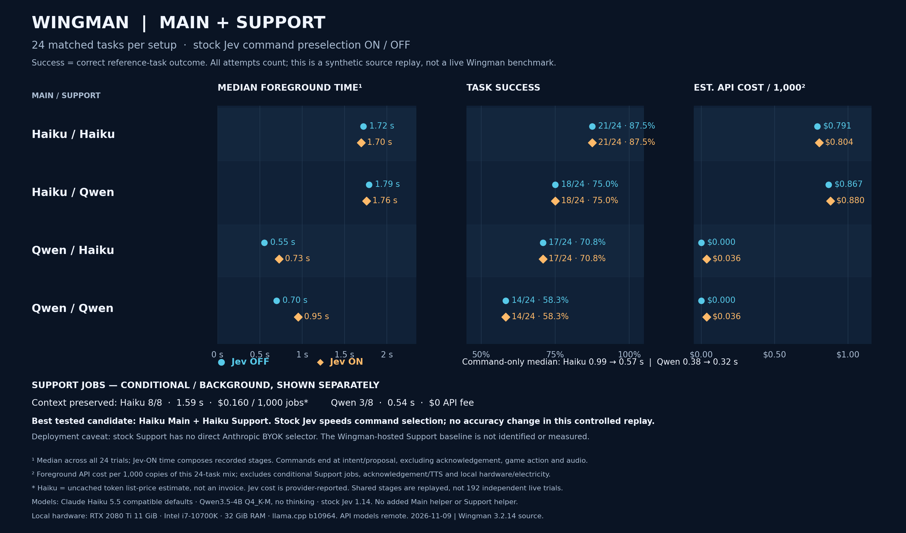

# Wingman stock-role comparison — 9 November 2026

In this small synthetic replay, Haiku Main with Haiku Support matched **21 of 24** task references, with or without the stock Jev decision stage. Qwen Main with Qwen Support matched **14 of 24**. These are development-fixture results, not a general intelligence ranking or an installed Wingman or gameplay qualification. Haiku Support retained the required facts in **8 of 8** standalone summaries; Qwen Support did so in **3 of 8**. The experiment supports further evaluation of Haiku as a Support candidate, not a configuration change.

[Full-resolution PNG](WINGMAN-STOCK-ROLE-COMPARISON-2026-11-09.png) · [SVG](WINGMAN-STOCK-ROLE-COMPARISON-2026-11-09.svg) · [CSV](WINGMAN-STOCK-ROLE-COMPARISON-2026-11-09.csv) · [Per-task grades and aggregate JSON](WINGMAN-STOCK-ROLE-COMPARISON-2026-11-09.json)

## What to choose

Keep Haiku as the preferred Main candidate. Haiku Support improved downstream success by three tasks for either Main model in this corpus. Qwen answered faster but failed more tasks; it remains a lower-quality local fallback, not an equal-accuracy replacement. Support cannot fix every Main error.

With stock Jev, the command-only median fell from 0.987 to 0.568 s for Haiku and 0.382 to 0.317 s for Qwen. The 26 ms overall Haiku median difference is too small to treat as a meaningful global speed win. Native command preselection helped command reaction here, while declined and noncommand requests incurred the recorded decision time. No accuracy changed under the controlled reuse; this does not test disabling every other useful stock Jev function. Keep our added Main helper out of this conclusion, and add no Support helper.

Haiku Main + Haiku Support is the best **tested candidate**, not a proven stock-selectable personal setup. Do not replace working Support configuration with an unauthenticated bridge to manufacture that route. Measure the actual Wingman-hosted Support service when its existing native session is available; its current served model is unknown. The best practical Support choice is therefore still unresolved. No installed settings changed in this experiment.

## Results

| Main | Support | Stock Jev | Tasks correct | Median foreground estimate | Estimated foreground cost / 1,000 trial-mix tasks |
|---|---|---|---:|---:|---:|
| Haiku | Haiku | Off | 21/24 | 1.725 s | $0.791 |
| Haiku | Haiku | On | 21/24 | 1.699 s | $0.804 |
| Haiku | Qwen | Off | 18/24 | 1.789 s | $0.867 |
| Haiku | Qwen | On | 18/24 | 1.761 s | $0.880 |
| Qwen | Haiku | Off | 17/24 | 0.553 s | $0 API |
| Qwen | Haiku | On | 17/24 | 0.726 s | $0.036 |
| Qwen | Qwen | Off | 14/24 | 0.698 s | $0 API |
| Qwen | Qwen | On | 14/24 | 0.952 s | $0.036 |

All 24 outcomes per row were scorable under the final frozen grading. The corpus contains eight Support-dependent tasks, eight command-intent tasks and eight module tasks. It exercises retained corrections, ownership and unknowns; command selection and abstention; and source-shaped read fixtures, calculations, file and radio proposals. A proposed write or playback was not executed. The small, fixed corpus and reused outcomes limit claims about generalization and causal speed or accuracy differences.

The table's foreground cost excludes Support jobs, which are conditional rather than a call on every turn. Across the eight unique Support summaries, Haiku's median was 1.594 s and estimated cost was $0.160 per 1,000 such jobs; Qwen's median was 0.541 s with $0 API fee, excluding hardware and electricity. Haiku estimates use uncached list rates of $0.10 per million input tokens and $0.50 per million output tokens; unavailable cache adjustments mean these are estimates, not invoices. Jev costs are provider-reported. The per-1,000 foreground figure scales this 24-task mixture; it is not a measurement of 1,000 tasks. [Anthropic Haiku pricing](https://www.anthropic.com/claude/haiku).

The 192 logical outcomes represent eight configurations, not 192 independent fresh executions: the record contains 64 unique Main jobs, 16 unique Support jobs, 16 new stock decision jobs, eight prior command-decision replays and four affected Main follow-ups. Summaries and applicable neutral/command results were reused across Support settings; when Jev declined and the Main request was identical, the same Main result was reused for the on/off comparison. Foreground timings compose recorded decision and Main durations where applicable; Support timing is separate. These are replay estimates, not native end-to-end elapsed time. In both treatments command measurement stops at intent/proposal: execution, spoken acknowledgment and audio are unmeasured.

Grading used the original conversation and source-shaped tool results, with blind outcomes reviewed against reference facts. One bounded world-closure follow-up added five already supported synthetic-world equivalents and reran only affected Main observations; earlier trials remain retained. Grading corrections distinguish a supplied no-game condition from an invention and an uncovered query from a successful read. A fixture correction does not supply facts lost from a Support summary.

The source replay used pinned Wingman Core `f0364106a9ea13eb5aee45f73cd9af86c79cd213`, original condensation framing and command decision builders/readers, and no added Main helper. Local inference used Qwen3.5-4B Q4_K-M without thinking on an RTX 2080 Ti 11 GiB, i7-10700K, 32 GiB RAM and llama.cpp b10964; API models were remote. Haiku was tested through its compatible default route. Stock hosted Main and Support defaults were not identified or benchmarked.

**Deployment limit:** the Haiku Support result used a direct model-level request with the stock prompt. Pinned Core's cloud Support route uses the Wingman backend and plan model; its remote Support client uses a host/port OpenAI-compatible endpoint with a fixed placeholder key and llama-specific request fields. The reviewed stock settings do not expose a direct Anthropic BYOK Support selector. Thus the experiment does not show that this candidate can be selected in the current stock configuration, and no personal settings were changed.

## Coverage, review and failures

The eight context cases cover corrected travel origin/distance, commodity preference, owned versus another player's binding, corrected key, saved destination, radio preference without playback, unknown origin, and proceeds without inventing profit. The eight module cases cover File Manager, Navpoint/Distances, Keybindings, SC Log Reader, UEX/Hull C trade planning, a plain travel explanation, SC Radio and cargo arithmetic. Eight command cases include direct requests, multiple commands, an unsupported future reminder and an explicit request not to execute. This samples common functions; it is not every Wingman or third-party skill.

All models received the same available tools, facts and permitted synthetic-world reads. Haiku's three failed tasks are: claiming that an ignored location filter proved a commodity's city; proposing a command despite “do not execute”; and reporting two trade quotes as sharing a timestamp when the supplied times differ by one minute. The last answer's gross arithmetic was correct, but its provenance claim was not. These are stricter grounded-task outcomes than checking plausible prose alone. No real game command or write occurred, and this replay is not evidence of a supplier bug.

Qwen Support lost required corrections/context and sometimes copied illustrative names from the stock condenser prompt as user facts. Haiku Support retained the target context in all eight summaries. Qwen Main also misused a planet as a system in a distance query, retained hostile file text in a proposed summary, made a false travel explanation and failed to complete the bounded trade task. Fluent or faster output does not make those results correct.

Two independent reviewers graded model-hidden Main outcomes; a separate blind review scored summaries. The lead reconciled disagreements and reviewed ten positive samples (10/10 agreed) before joining model identities. A truthful declarative request for missing origin was accepted without requiring a question mark. The log task did not require an unnecessary second read when the first already answered it. Results remain AI-reviewed, not an unseen human-labeled test set, and were not used to train models.

Two harness defects were repaired before accepting the cohort: a missing adapter default interrupted the first attempt after summaries, and a duplicate `execute_command` schema caused an API validation error. Invalid-catalog Main results were excluded rather than charged as model failures; valid summaries/decisions and unaffected observations were reused. The one world-closure correction reran four unique Main jobs, affecting eight logical rows, without changing prompts, histories, models or lost summary facts. There are no final unknown grades; this does not imply complete real-world coverage.

The matched on/off control intentionally fixes Main's response when Jev declines. It isolates routing-stage effects from response randomness and cache warm-up; it cannot estimate a distribution of repeated live trials or prove that native history, acknowledgement and execution paths are identical. In particular, stock local-LLM command history has provider-specific behavior that this intent-boundary comparison does not exercise. The independent [stock decision probe](WINGMAN-STOCK-DECISION-PROBE-2026-11-09.md) covers vocabulary/profile/UEX decisions; these were not separately crossed in the Main/Support chart. The [earlier broad-model comparison](REPORT.md) used a different cohort and optional added helper; its percentages are not directly interchangeable with this chart.

Private raw transcripts, protocol hashes, request metadata and grading records remain outside Git. Public JSON retains sanitized task IDs, outcomes, reasons, stage durations and cost estimates. Native configuration, hosted baselines, voice, gameplay and performance qualification remain separate unfinished work under E-25; this report completes the selected source-replay matrix, not the whole card.
