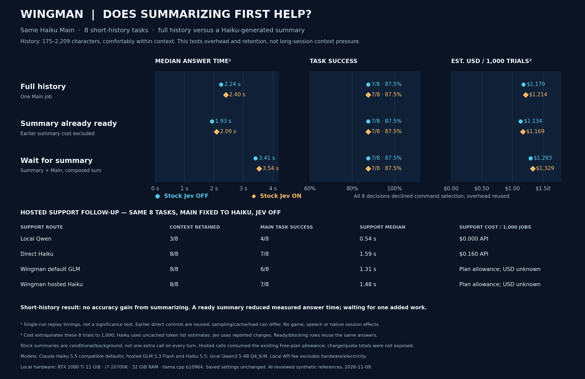

# Wingman Support follow-up — 9 November 2026

On eight short, history-dependent development tasks, Haiku Main matched **7/8 references** both with the full history and with a previously prepared Haiku Support summary. This is a separate follow-up to the [24-task stock-role comparison](WINGMAN-STOCK-ROLE-COMPARISON-2026-11-09.md), not 24 additional tasks or a long-context test. Histories ranged from 175 to 2,209 characters.

| Context supplied to Haiku Main | Correct | Median | Estimated cost per 1,000 tasks |
|---|---:|---:|---:|
| Full history | 7/8 | 2.245 s | $1.179 |
| Haiku summary already available | 7/8 | 1.930 s | $1.134 |
| Hypothetical blocking Haiku summary, then Main | 7/8 | 3.412 s | $1.293 |

The summary-ready row excludes the earlier Support call. The blocking row composes one measured Support call with each answer; it is an estimate, not an observed native foreground pipeline. The full-history calls are new; summary controls were recorded earlier. Cache state, sampling and order differ, so the comparison does not establish a causal latency or accuracy advantage. Costs are uncached token-rate estimates, not invoices, and scale this eight-task mix rather than measure 1,000 new calls.

The stock Jev decision stage selected no command for all eight requests. Its recorded decisions and the unchanged Main outputs were reused for the on/off comparison; adding the stage adds its measured overhead and cost without changing these answers. This is a source-based replay, not an installed Core session, and does not measure speech or gameplay effects.

## Wingman hosted Support

The original hosted provider returned **`zai/glm-5.3-flash`** for the plan default; **`anthropic/claude-haiku-5.5`** was also selectable on the Free plan and returned successful responses. Both produced summaries retaining the required task context in **8/8** cases. With Haiku Main reading those summaries, the downstream result was **6/8** for hosted GLM and **7/8** for hosted Haiku. There were 16 hosted Support jobs and 16 downstream Main jobs, plus eight full-history Main jobs; a Main job may make multiple HTTP calls during tool use. Hosted Support dollar charges and quota use were not reported; they are unknown, not zero. The original personal settings were unchanged.

| Support route | Needed context retained | Haiku Main correct | Median Support job | Support cost per 1,000 jobs |
|---|---:|---:|---:|---|
| Existing local Qwen | 3/8 | 4/8 | 0.541 s | $0 API fee; hardware/electricity excluded |
| Direct Haiku | 8/8 | 7/8 | 1.594 s | $0.160 uncached estimate |
| Wingman default GLM | 8/8 | 6/8 | 1.313 s | Free-plan allowance; dollar/quota charge unknown |
| Wingman hosted Haiku | 8/8 | 7/8 | 1.483 s | Free-plan allowance; dollar/quota charge unknown |

The hosted tests executed the unchanged pinned `WingmanSupport` provider class with isolated in-memory settings and the existing subscription credential obtained through Core's SecretKeeper route. Synthetic histories and original condensation framing were used. No key was serialized; no live conversation, memory store or saved setting was changed. This measures the real hosted service, not the installed condenser's scheduling/chunking or a complete native session. Returned identifiers prove these particular responses, not a permanent gateway routing guarantee. The direct Haiku and Qwen controls are earlier observations; different endpoints, sampling, caching and load prevent attributing small differences solely to the model.

Blind review corrected H06 and H07 to pass because the necessary context survived even though not every reference phrase appeared. D23 remains a failure: the answer treated a commodity location filter as confirmation even though the supplier ignores that filter for the named-commodity query. This is a model-answer finding in the fixture, not a claim of a supplier defect. Unchanged earlier results and grading history remain retained.

The lead reviewed all initially failed Main outcomes and twelve initially positive outcomes, catching D23's inconsistent pass before publication. The final 24 new downstream/full-history outcomes contain 20 passes, four failures and zero unknowns. The other failures are incomplete city confirmation despite an available covered location read, and claiming a recent-events lookup returned nothing when that query was a fixture gap. “Available read” is not “read actually executed.” A cautious but incomplete answer can fail task completion without being a fabricated value.

## Practical conclusion

There is no demonstrated accuracy gain from an extra summarization job in these short histories. The ready-summary answer median was about 14% lower; the hypothetical blocking sum was about 52% higher than full history. The corresponding foreground cost estimates were about 4% lower (earlier summary excluded) and 10% higher (one summary included per answer). These are descriptive single-run observations, not statistically established speedups or a general bill forecast. Stock Support is conditional/background; it does not summarize every question before Main.

Keep Haiku as the preferred Main candidate and avoid making every reply wait for a summary. The existing local Support route lost useful context in the earlier test. Stock hosted Haiku now offers a concrete supported alternative under the existing plan allowance, without adding a direct-BYOK Support bridge; its finite allowance and failure behavior still matter. No personal selection was applied here. Waterfall currently routes Main only; optional role or memory-policy controls are a separate design question, to reuse supported Core settings rather than silently disabling memory. The actual hosted Main baseline, full memory pipeline and native configuration qualification remain outside this follow-up.

The sample is small and exposed development data; a source-based model-stage replay does not establish installed-session performance or general accuracy. The full-history result does not show that summarization is unnecessary when a session approaches its context limit. See [session-memory research](WINGMAN-SESSION-MEMORY-RESEARCH-2026-11-09.md).

[Chart PNG](WINGMAN-SUPPORT-FOLLOWUP-2026-11-09.png) · [SVG](WINGMAN-SUPPORT-FOLLOWUP-2026-11-09.svg) · [JSON](WINGMAN-SUPPORT-FOLLOWUP-2026-11-09.json) · [CSV](WINGMAN-SUPPORT-FOLLOWUP-2026-11-09.csv)
