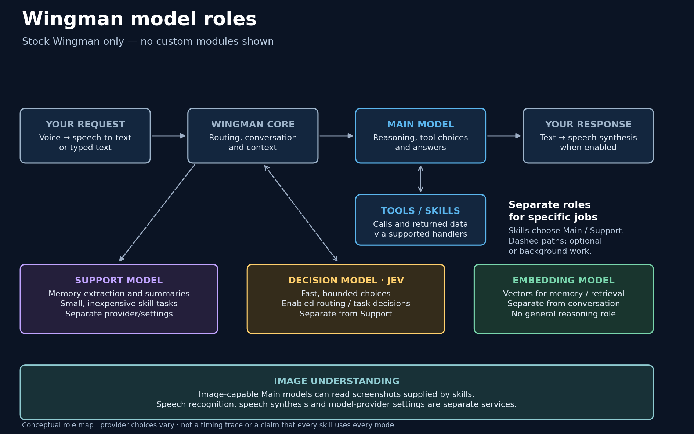
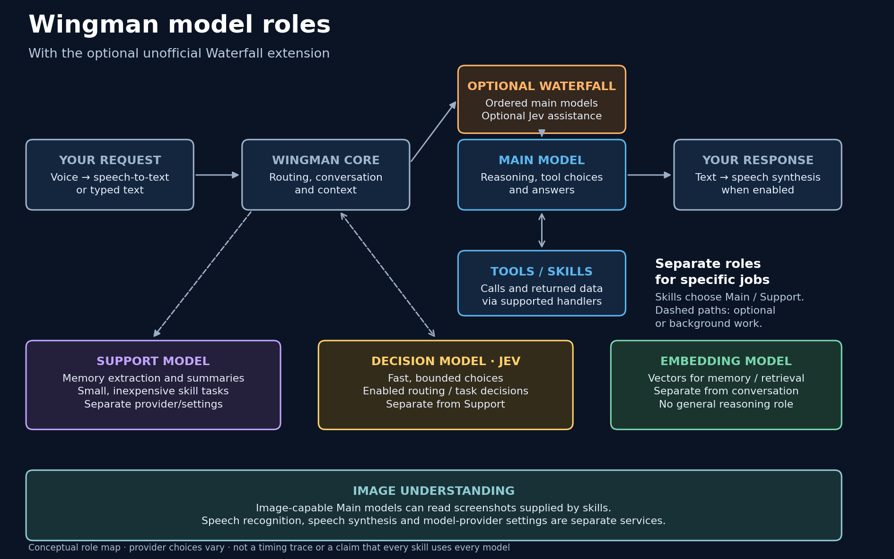

# Wingman model roles

**Waterfall belongs on the main conversation model.** That model handles the
conversation, reasoning, tool choices and tool arguments. Improving only the
support model would not improve those main-model decisions or replace Jev.

The stock map omits our extensions. This second map adds them explicitly:

| Role | Job | Waterfall scope |
|---|---|---|
| Main conversation model | Understand requests, reason, choose tools, interpret results and answer. Skills can explicitly make main-model side calls too. | The configured main provider points at Waterfall; it selects the preferred model or an eligible backup. |
| Support model | Background memory extraction, conversation summaries and inexpensive, explicitly requested skill work. | Its global setting remains separate. These main-model benchmark results do not rank support-task quality. |
| Decision model / Jev | Fast, bounded choices through Wingman's decision interface. Enabled uses depend on the task/settings. | Wingman's own Jev route remains separate. Optional per-route assistance reuses that interface before a main-model tool choice; it does not replace the main model. |
| Embedding model | Turn text into vectors for memory/retrieval. | Separate from the conversation route and generative reasoning. |
| Speech recognition / synthesis | Convert microphone audio to text and response text to audio. | Separate STT/TTS settings and services. |
| Image-capable main model | Read screenshots supplied by skills. | These main-model calls follow the configured main provider. |

Skills generally use these shared roles rather than each having an independent
AI agent. A skill chooses an interface for a particular job. In the reviewed
Core, Proactive Comments and SC Game Events have main-model calls and configured
local/support branches; UEX and Spotify also use typed System One decisions.
Those examples do not imply every request passes through every model.

## What Waterfall changes

Waterfall is selected as a Wingman main conversation provider. Its ordered routes affect main-model calls, including explicit skill main-model side calls. Support, Jev, embedding and speech settings remain separate. Optional Jev assistance reuses the configured public decision interface.

The accompanying 24-task comparison is a main-model/tool benchmark. It does not rank Support memory extraction or background summarization. No benchmark rerun or Support setting change was needed for this role clarification.

## Source trace

Reviewed official Core commit: `f0364106a9ea13eb5aee45f73cd9af86c79cd213`.
The current main ref was rechecked on 2026-11-09. Simon's explanation prompted
this audit; the source paths independently establish the distinctions.

- [`ProviderFactory.create_llm`](https://github.com/ShipBit/wingman-ai/blob/f0364106a9ea13eb5aee45f73cd9af86c79cd213/services/provider_factory.py) selects the configured conversation provider.
- [`Wingman.actual_llm_call`](https://github.com/ShipBit/wingman-ai/blob/f0364106a9ea13eb5aee45f73cd9af86c79cd213/wingmen/wingman.py#L849) calls that main provider.
- [`SkillAi`](https://github.com/ShipBit/wingman-ai/blob/f0364106a9ea13eb5aee45f73cd9af86c79cd213/wingmen/facade.py#L315) exposes main-model generation, including image input.
- [`SkillLocalAiView`](https://github.com/ShipBit/wingman-ai/blob/f0364106a9ea13eb5aee45f73cd9af86c79cd213/wingmen/facade.py#L514) exposes the separate support, summary and embedding interfaces.
- [`SkillSystemOne`](https://github.com/ShipBit/wingman-ai/blob/f0364106a9ea13eb5aee45f73cd9af86c79cd213/wingmen/facade.py#L1871) exposes typed decisions.

Engineering modules are deliberately omitted from these shareable diagrams.
The two maps show stock Wingman directly calling its main provider, then the
same route with optional Waterfall inserted. Support and Jev remain separate
in both versions.

The [stock diagram source](diagrams/WINGMAN-MODEL-ROLES.mmd) and
[extension diagram source](diagrams/WINGMAN-MODEL-ROLES-EXTENSIONS.mmd) are role maps, not a
claim that all skills, providers or runtime combinations are independently tested.
